&nbsp;&nbsp;

## ✦ About me

- 🎓 **M.S. Applied Data Science @ UChicago** (2026 – 2027) · Finance @ ZUEL (2021 – 2025)
- 🤖 Building **LLM agents & agentic RAG**, from research tooling to multi-agent decision reports
- 📈 Empirical economist at heart: **labor, innovation, ESG & digital governance**, mostly staggered DID
- 🧪 Also exploring **multimodal metaphor detection** and multimodal information fusion
- 🏆 2nd Prize · Adventure-X 2026 (ZILO track) &nbsp;·&nbsp; Honorable Mention · MCM 2025 &nbsp;·&nbsp; FRM Part I
- 💬 *Economics is for the fun, coding is the future.*

## ✦ LinkedIn

## ✦ Featured projects

**三安计量学社 · learning series**

| [Machine Learning](https://github.com/vacucity/ML-for-Sanan-Li) | [Deep Learning](https://github.com/vacucity/DL-for-Sanan-LI) | [Reinforcement Learning](https://github.com/vacucity/RL-for-Sanan-Li) | [RAG](https://github.com/vacucity/RAG-for-Sanan-Li) | [CS336 · LM from scratch](https://github.com/vacucity/cs336-for-Sanan-Li) | [Agents](https://github.com/vacucity/Agent_learning) |
|:-:|:-:|:-:|:-:|:-:|:-:|
|  |  |  |  |  |  |

## ✦ Research

- **Digital Transformation and Stock Market Manipulation: Evidence from High-frequency Trading Data** *Applied Economics* · published
- **Government Open Data and Corporate Risk-Taking: Evidence from China** *Finance Research Letters* · published

Under review & working papers (5)

- **The Capital Response to the "Green Signal": How Does the Recognition of Green Factories Mitigate ESG Rating Disagreements?** *Research in International Business and Finance* · under review
- **Can Judicial Deterrence Curb Corporate "Say-Do Discrepancies"? A Quasi-Natural Experiment from the Environmental Courts** *Journal of Business Ethics* · under review
- **Digital Tax Governance: Can Tax Authority Official Accounts Curb Corporate Tax Violations?** *Corporate Governance: An International Review* · under review
- **The Structural Origins of Data-Asset Mismatch: A Dynamic Perspective** Selected into the 2026 China Economics Annual Meeting
- **The Effect of the Minimum Wage: Why Do the Top Waves Splash Higher When a Stone Hits the Water?** Selected into the 9th Annual Conference on Labor Economics

Abstracts and links → [vacucity.github.io](https://vacucity.github.io)

## ✦ Tech stack

## ✦ On GitHub

<!-- Assets are generated by scripts/build.mjs and refreshed daily by .github/workflows/refresh.yml -->
